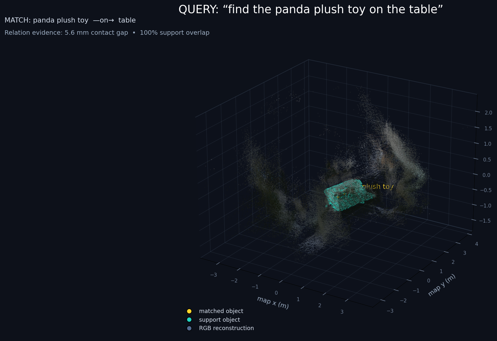
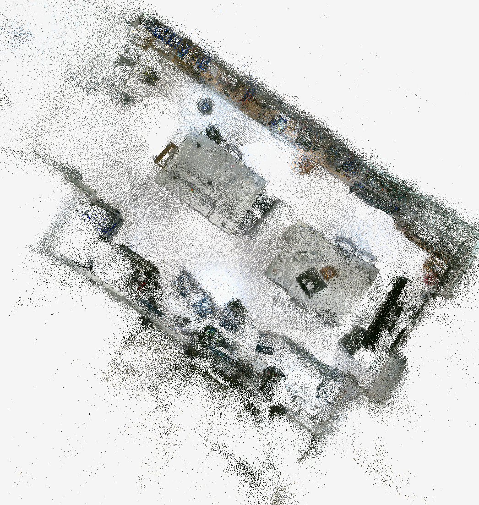
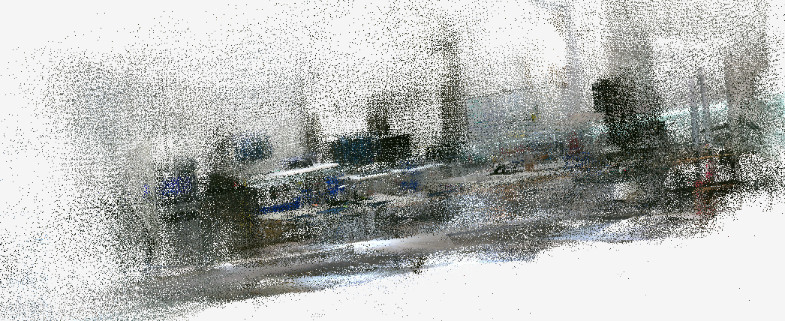
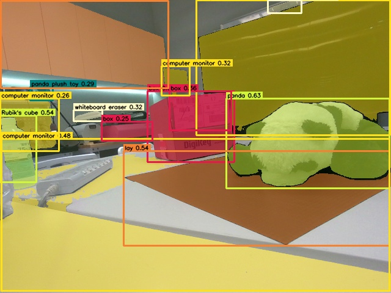
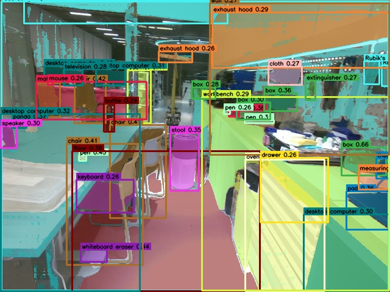

# 2026-11-04 — 官方 ConceptGraphs 桌面驗證與完整實驗室資料集

### 本次目標

- 先以桌面場景走通官方 ConceptGraphs 的 Grounded-SAM、3D object fusion、
  文字查詢與空間關係流程。
- 將測試由固定兩類擴充為 RAM 自動標籤加上少量重要提示詞的
  open-vocabulary 模式，讓同一套流程能處理不同場景與物件。
- 重新錄製完整實驗室的靜態 RTAB-Map 地圖，匯出成 posed RGB-D dataset，
  並在昂貴的 293 幀語意推論前完成幾何驗證。

### 完成內容

#### 1. 桌面場景完整 ConceptGraphs 流程

- 使用 `table_test_2026-11-04_01` 場景，共 82 組 RGB、aligned depth 與
  optimized camera pose。
- 修正 upstream `RealsenseDataset` 對 distortion 的處理問題：保留原始
  `camera_config.yaml` 作為相機校正紀錄，另輸出不含 distortion 的
  `camera_config_conceptgraphs.yaml`，避免只校正 RGB、卻沒有同步扭曲 aligned
  depth 所造成的 pixel misalignment 與 OpenCV `undistort` 型別錯誤。
- 以 `panda plush toy` 和 `table` 完成 Grounding DINO + SAM 82 幀推論。
- `cfslam_pipeline_batch.py` 成功輸出桌面場景的 3D object map：
  `full_pcd_custom_panda_table_full_v1_panda_table_v1_post.pkl.gz`。
- 新增 `offline_tools/query_object_map.py`：
  - 支援 exact/近似 label 與 CLIP open-vocabulary 排序；
  - 輸出候選物件的 centroid、AABB、點數與觀測次數；
  - 依 target 與 reference robot XY 產生面向物件的候選
    `PoseStamped`；
  - 明確標示該 pose 尚需 Nav2 costmap 驗證，不能直接當成安全導航目標。
- 新增 `offline_tools/infer_support_relations.py`，以支撐物 dominant plane、
  接觸間隙、相對高度與 footprint overlap 推論有向
  `panda plush toy --on--> table` 關係。
- 實測支撐關係通過全部幾何條件：
  - table plane inlier ratio：`0.773201`；
  - panda footprint overlap：`1.0`；
  - 5% contact gap：`0.006327 m`；
  - median height：`0.061589 m`。
- 新增 `offline_tools/visualize_query_map.py`，在 Open3D 視窗中同時顯示：
  reconstructed RGB scene、各 instance 點雲/AABB、文字查詢結果與 relation
  edge。CLIP 模式以紫藍到黃色的 similarity heatmap 顯示結果，relation 模式
  以黃色標示 subject、青色標示 support。

#### 2. 官方 Grounded-SAM 前端擴充

- `generate_gsa_results.py` 新增 `--class_set custom` 與
  `--custom_classes`，可處理任意指定物件，不再綁定舊資料集類別。
- 新增 `--extra_classes`，可在 RAM/Tag2Text 自動類別之外保留重要查詢詞，
  例如 `Rubik's cube`、`panda plush toy`、`whiteboard eraser`、
  `cardboard box` 與 `table`。
- 新增 `--low_vram`：RAM、Grounding DINO、SAM、CLIP 依序移入 GPU，完成
  當前步驟後移回 CPU，讓約 8 GiB VRAM 的 RTX 4060 Laptop GPU 可以執行
  官方 ViT-H/ViT-H-14 模型組合。
- `compute_clip_features()` 不再硬編碼 `cuda`，改用呼叫端傳入的 device。
- dense-SAM、box-conditioned SAM、DINO、RAM/Tag2Text 與 CLIP 路徑都加入相同
  的低顯存切換邏輯。

#### 3. 完整實驗室靜態地圖

- 重新錄製 `lab_static_full_2026-11-04_02.db`，RTAB-Map database 大小
  `139 MB`。
- 掃描階段只執行 D455 RGB-D 與 RTAB-Map；RealSense IMU 關閉，所有語意
  模型改為錄製完成後離線執行，避免推論負載造成資料掉幀。
- 使用 `rtabmap-export --images --images_id --poses_camera --poses_format 11`
  匯出最佳化相機姿態與 RGB-D keyframes。
- 轉換後共有 293 組 RGB、depth、pose，三者數量完全一致。
- 解析度為 640 x 480，深度上限 5 m，中位有效深度比例為 `0.786462`。
- camera translation bounds：
  - X：`-3.720844` 至 `2.649939 m`；
  - Y：`-1.589182` 至 `4.022551 m`；
  - Z：`-0.441015` 至 `0.732933 m`。
- `validate_posed_rgbd.py` 以每 8 pixel 取樣全部 293 幀，共產生
  `1,049,432` 個驗證點；PLY、XY 俯視圖與 XZ 側視圖均已通過人工檢查。

#### 4. 完整實驗室 open-vocabulary probe

- 先以 `stride=30` 從整段路線均勻抽取 10/293 幀。
- RAM + Grounding DINO + SAM + CLIP 全部成功完成，平均約 `9.28 s/frame`。
- 產生 10 個 `.pkl.gz` detection files 與 10 張視覺化圖片。
- RAM 加上重要 extra classes 共收集 77 個類別，包括 table、chair、cabinet、
  computer、monitor、microscope、panda、Rubik's cube、whiteboard eraser、
  cardboard box、wall、floor 與 ceiling。
- probe 也顯示 open-vocabulary 單幀偵測仍有低信心誤判與錯誤文字 token；
  後續 3D fusion 必須要求多視角、幾何位置一致與最少觀測次數，不能把單張
  prompted detection 視為物件存在的充分證據。

### 本日相容性問題與處理

#### `PYTORCH_CUDA_ALLOC_CONF`

- `conceptgraphs-official` 使用 PyTorch 2.0.1；此 allocator 不支援
  `expandable_segments:True`。
- 設定該值會在第一次 CUDA 初始化時出現
  `RuntimeError: Unrecognized CachingAllocator option: expandable_segments`。
- 本環境必須執行 `unset PYTORCH_CUDA_ALLOC_CONF`；`--low_vram` 保留。

#### MP4 backend

- 10 幀 probe 的 AI 推論已完整成功，但最後 `imageio.mimsave()` 因環境沒有
  FFMPEG/PyAV backend 而無法建立 MP4。
- MP4 只供展示，不是 cfslam 的輸入；後續完整推論暫時移除
  `--save_video`，保留逐幀 JPG 與 `.pkl.gz`。
- 若日後需要展示影片，可另外安裝並釘選 FFmpeg backend，再由既有 JPG
  產生影片，不必重新執行模型。

#### Grounding DINO phrase warning

- 推論期間出現 `There's a wrong phrase happen` 是 Grounding DINO 的 token
  merge/post-process 警告。
- 它不會中止遮罩輸出，但可能讓少數 box 得到隨機 label，因此必須依靠後續
  多視角 3D fusion 與 object query 排序降低影響。

### 今日停止位置

- 完整實驗室推論目標：293 幀。
- 停止前已產生：`11/293` detection files 與 `11/293` visualization JPG。
- 目前沒有 `generate_gsa_results.py` 或 `cfslam_pipeline_batch.py` 在背景執行。
- 現有 upstream script 沒有 skip-existing/resume 功能；下次直接使用相同完整
  指令會從第 0 幀重新處理並覆寫前 11 幀。
- 尚未執行完整實驗室的 `cfslam_pipeline_batch.py`，因此今天不宣稱已完成
  實驗室 3D semantic object map。

### 驗證結果

- 所有本次新增或修改的 Python 檔案均通過 `py_compile`。
- 三個 offline tools 的 `--help` 均可執行。
- `generate_gsa_results.py --help` 在設定正確 `GSA_PATH` 的
  `conceptgraphs-official` 環境中通過。
- `query_object_map.py` 實際回歸測試：label query 最佳結果為
  `panda plush toy`，similarity `1.0`，並產生 candidate-only goal。
- `infer_support_relations.py` 實際回歸測試：1 個 relation candidate、1 個
  accepted `on` relation。
- `git diff --check` 通過。

目前 AI 環境：

| 元件 | 版本/狀態 |
| --- | --- |
| Python | 3.10.22 |
| PyTorch | 2.0.1 |
| PyTorch CUDA runtime | 11.8 |
| NumPy | 1.24.4 |
| OpenCV | 4.8.0 |
| GPU | NVIDIA GeForce RTX 4060 Laptop GPU, 8188 MiB |
| NVIDIA driver | 595.99.02 |
| CUDA available | True |

### Git 與本機資料邊界

本次提交 GitHub：

- open-vocabulary 與 low-VRAM upstream modifications；
- ConceptGraphs 專用 camera config 輸出；
- object query、candidate goal、support relation 與 3D query viewer 工具；
- 操作文件、今日紀錄與少量說明圖片/JSON evidence。

不提交 GitHub：

- 139 MB RTAB-Map database；
- 完整 RGB、depth、pose dataset；
- Grounding DINO、SAM、RAM 與 CLIP 權重；
- 3D object map pickle、PLY 與全部 293 張推論輸出；
- Conda environment、CUDA runtime cache 與 Hugging Face cache。

### 下次續作

1. 在 `conceptgraphs-official` 環境設定 `GSA_PATH`，確認
   `PYTORCH_CUDA_ALLOC_CONF` 已 unset。
2. 重新執行完整 293 幀 `generate_gsa_results.py`，使用
   `--class_set ram --low_vram --exp_suffix lab_open_vocab_v1`，先不要使用
   `--save_video`。
3. 驗證 RGB、detections、visualizations 都是 293。
4. 使用 `gsa_variant=ram_lab_open_vocab_v1` 執行
   `cfslam_pipeline_batch.py`，並以 `obj_min_detections >= 3` 過濾短暫單幀誤判。
5. 檢查 post-processed 3D object map 的重複節點、錯誤類別與背景表面。
6. 用 CLIP 查詢 `Rubik's cube`、`panda plush toy` 等物件；需要空間語意時再
   建立 `on` 等具 evidence 的 relation。
