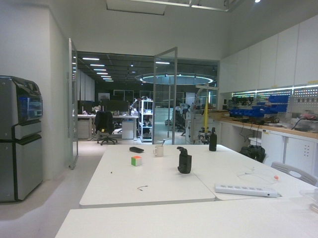
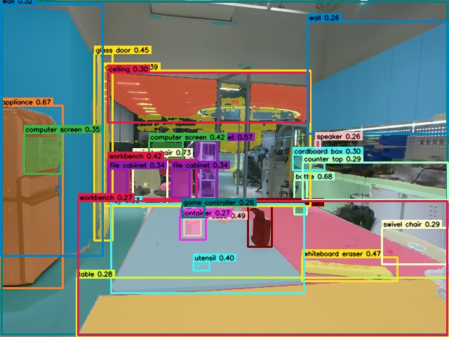
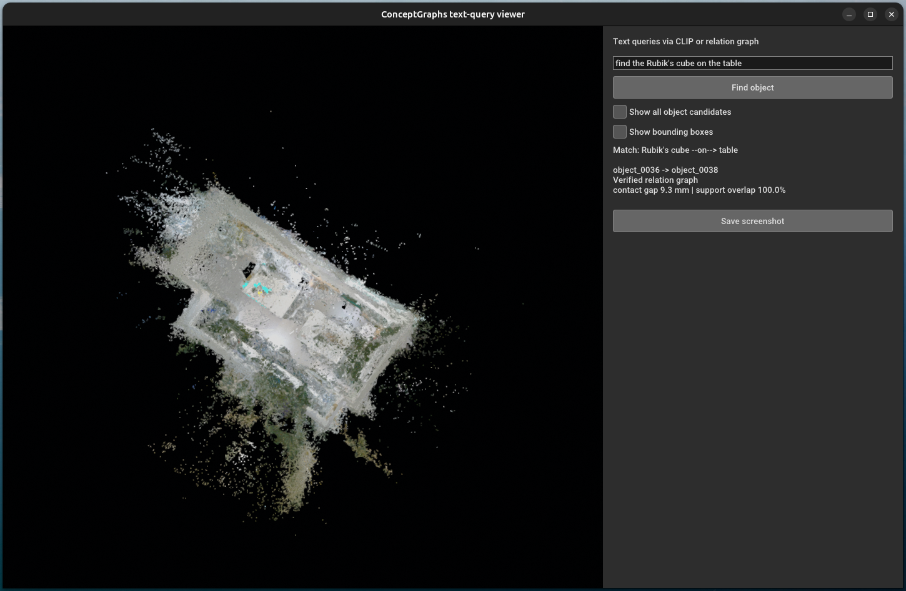

# 2026-11-05 — 完整實驗室語意圖、魔術方塊查詢與乾淨視覺化

### 本次目標

- 接續昨日完整實驗室資料集，完成全部 293 幀的 open-vocabulary 推論與
  ConceptGraphs 3D object fusion。
- 在完整實驗室地圖中找出桌上的魔術方塊，並以幾何證據建立
  `Rubik's cube --on--> table` 關係。
- 改善原始 object map 將數百個候選點雲與 AABB 同時顯示所造成的混亂，讓
  查詢畫面更接近官方網站的 object-level query 展示。

### 完成內容

#### 1. 完整 293 幀 open-vocabulary 推論

- `lab_static_full_2026-11-04_02` 的 RAM + Grounding DINO + SAM 推論已全部
  完成。
- detection files：`293/293`。
- visualization JPG：`293/293`。
- `cfslam_pipeline_batch.py` 已完成完整 3D fusion 與 post-processing：
  - raw map：`full_pcd_ram_lab_open_vocab_v1_full_lab_v1.pkl.gz`，
    `69,450,770 bytes`；
  - post map：`full_pcd_ram_lab_open_vocab_v1_full_lab_v1_post.pkl.gz`，
    `37,411,457 bytes`（`35.68 MiB`）。
- post map 包含 349 個 foreground object nodes、3 個 background objects，
  以及 72 個不同的 majority labels。
- 目前節點數量很多，並且存在同一物件被拆成多個節點、錯誤類別與大型混合
  segment；因此 raw object map 不可直接視為已清理完成的 semantic graph。

#### 2. 魔術方塊候選驗證

- 使用 CLIP query 搜尋 `a Rubik's cube`，再回查候選節點對應的原始 RGB 與
  Grounded-SAM 視覺化影格。
- `object_0036` 在第 12–16 幀對應到桌面上的綠橘色魔術方塊，確認為真正
  目標：
  - 5 次觀測；
  - majority-label purity：`1.0`；
  - 64 個 post-processed 3D points。
- 另外三個 Rubik's-cube 候選中：
  - `object_0038` 是混合了桌面、workbench 與 cube label 的大型 segment；
  - `object_0049` 只有 3 次觀測，來源影格沒有真正魔術方塊；
  - `object_0082` 混入 yoga mat、pad、cloth 等標籤，來源影格同樣不是目標。
- 這證明單靠 majority label 或單次文字相似度不足以建立可靠節點；必須加入
  多視角觀測、label purity、點數、幾何與來源影格驗證。

原始 RGB 中可清楚看到桌上的魔術方塊：

同一幀的 open-vocabulary 偵測能涵蓋目標，但也同時出現多個低信心或錯誤
標籤，後續必須靠 3D fusion 與品質條件過濾：

#### 3. 建立 `Rubik's cube --on--> table` 幾何關係

- `infer_support_relations.py` 新增 `--subject-id` 與 `--support-id`，允許先從
  來源影格驗證物件，再指定確切 3D node，避免 noisy majority label 選錯。
- 輸出的 edge 使用人工驗證後的 semantic labels，同時以
  `source_map_label`、`target_map_label` 保存自動 fusion 的原始 label，避免
  刪除 provenance。
- 驗證後的 directed edge：
  `object_0036 Rubik's cube --on--> object_0038 table`。
- 幾何證據：
  - support plane inlier ratio：`0.818182`；
  - subject footprint overlap：`1.0`；
  - 5% contact gap：`0.009274 m`；
  - median height above plane：`0.044877 m`；
  - support plane、contact gap、subject height、footprint overlap 四項條件
    全部通過。
- 完整 machine-readable evidence：
  [`rubiks-cube-on-table-relation.json`](artifacts/2026-11-05/rubiks-cube-on-table-relation.json)。

#### 4. 改善 ConceptGraphs 查詢視覺化

原始 viewer 每次查詢都同時疊加 349 個 object point clouds 與 349 個 AABB，
因此即使最佳候選正確，使用者仍難以判斷目標位置。今天修改
`visualize_query_map.py`：

- reconstructed RGB point cloud 保留為較明亮的場景背景；
- 一般 label/CLIP query 預設只顯示前 5 名候選；
- relation query 只顯示 subject、support 與 relation line；
- 最佳目標固定使用黃色、支撐物使用青色；
- AABB 與全部候選預設隱藏，可用 GUI checkbox 開啟除錯；
- 右側顯示 object ID、label、query score、observation count 與 label purity；
- 新增 CLI 參數：`--top-k`、`--min-observations`、
  `--min-object-points`、`--min-label-purity`、`--show-all-objects`、
  `--show-boxes`、`--scene-brightness`。

#### 5. 靜態地圖品質閘門

查詢器目前預設只接受：

- observation count `>= 5`；
- 3D point count `>= 50`；
- majority-label purity `>= 0.60`。

以目前 349 個 foreground nodes 實測，符合上述三項條件者為 111 個。真正的
`object_0036` 保留，而已驗證的低觀測或混合標籤假候選會被排除。這個數字
代表候選節點數減少，不代表已量測 false-positive rate 或 accuracy；正式精度
仍需建立人工標註的查詢測試集。

### 驗證結果

- `visualize_query_map.py` 與 `infer_support_relations.py` 通過
  `python -m py_compile`。
- 所有新增 CLI 參數均可由 `--help` 正常列出。
- Open3D GUI 已以完整實驗室 map、RGB PLY 與 relation JSON 實際啟動，沒有
  import、GUI API 或 map loading 錯誤。
- relation query 回傳：
  `object_0036 Rubik's cube -> object_0038 table`。
- `git diff --check` 通過。

### Git 與本機資料邊界

本次提交 GitHub：

- verified object-ID support relation 功能；
- 改善後的 text-query viewer 與品質閘門；
- 操作文件；
- 今日紀錄、3 張說明圖片與 relation JSON evidence。

不提交 GitHub：

- 293 組 RGB、depth、pose 與 Grounded-SAM 完整輸出；
- 69 MB raw object map 與 35.68 MiB post-processed object map；
- 15 MB fused PLY、RTAB-Map database、模型權重與 Conda environment；
- Hugging Face、CUDA 與模型 cache。

### 尚未完成與下次續作

目前已完成「完整實驗室 posed RGB-D → open-vocabulary masks → 3D object map
→ 文字查詢 → verified spatial edge」的一次完整流程，但還不能宣稱已得到和
官方展示相同品質的 semantic graph。下次工作：

1. 保留 raw map，另建立 curated semantic map，不破壞原始推論結果。
2. 依 multi-view observation、label purity、point count、object extent、
   spatial overlap 與 CLIP similarity 合併重複節點並排除錯誤節點。
3. 為重要靜態類別建立 canonical labels，保留所有原始 label votes 作為
   provenance。
4. 建立包含正確答案的固定 query benchmark，量測 top-1/top-5 retrieval，
   不以單一成功案例代表整體準確率。
5. 將 query result 轉成 AMR 可使用的 target location，並用 occupancy map、
   footprint 與 Nav2 costmap 產生真正可行的 goal pose。
